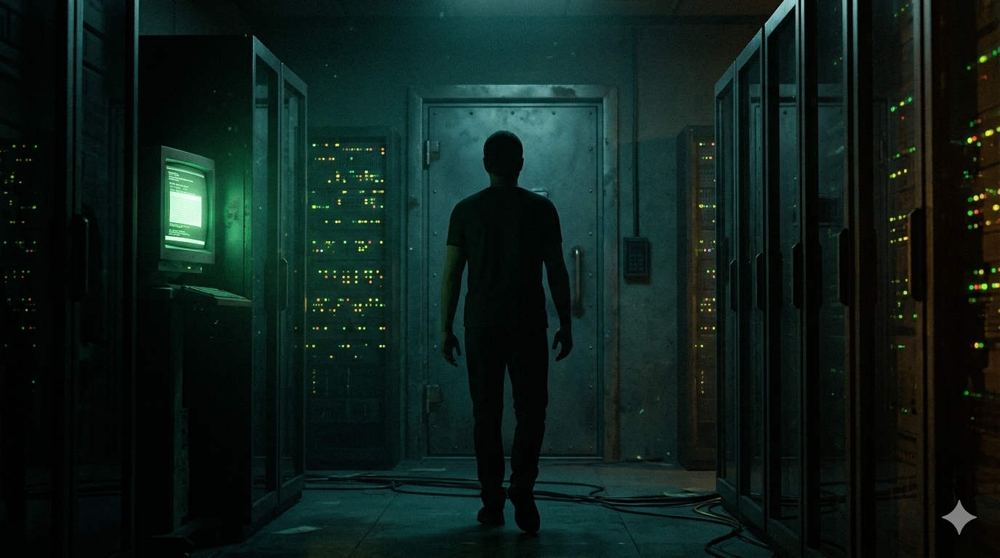

# 서버룸 0번 방

브라우저에서 하는 방탈출 게임입니다. 폐업 직전의 IT 회사 지하 서버룸에서 깨어나, 건물 관리 AI "루멘"과 대화하며 밖으로 나가야 합니다.

**바로 하기 → https://idayon.github.io/lumen/**



## 어떤 게임인가

- 5장 구성, 방 14곳, 퍼즐 20여 개, 플레이 시간 약 2시간 30분
- 실제 시간으로 150분 제한. 게임 속 시계는 21:00에 시작해 23:30에 끝납니다
- 엔딩 7종 (히든 엔딩 포함)
- 장마다 자동 저장되고, 깬 장은 다시 고를 수 있습니다

## 루멘은 거짓말을 합니다

루멘은 힌트를 주는 조력자이지만, 가끔 틀린 답을 알려 줍니다. 그대로 따라 하면 손해를 보고, 의심해서 직접 확인하면 거짓말을 잡아낼 수 있습니다.

- 거짓말을 잡아낸 횟수와 루멘의 진짜 도움을 받아들인 횟수로 **신뢰도**가 정해집니다
- 신뢰도와 모은 **기억 조각** 7개, 마지막 선택에 따라 엔딩이 갈립니다
- 루멘이 왜 거짓말을 하는지는 끝까지 가야 알 수 있습니다

"AI가 하는 말을 어디까지 믿을 것인가"를 게임 규칙으로 만들어 보고 싶었습니다.

## 구조

| 파일 | 내용 |
|---|---|
| `index.html` | 화면 틀과 스타일 |
| `js/engine.js` | 공통 엔진: 상태, 저장, 대화, 선택지, 방과 조사 지점, 시계, 힌트, 엔딩 |
| `js/ch1.js` ~ `ch5.js` | 장별 방, 퍼즐, 대사 |
| `bg/` | 배경 이미지 |
| `SCENARIO.md` | 설계 문서 (스포일러) |
| `ANSWERS.md` | 제작자용 정답표 (스포일러) |
| `index_v1.html` | 첫 버전 (서버룸 한 방, 60분) |

서버 없이 정적 파일만으로 돌아가고, 진행 상황은 브라우저에 저장됩니다. 방과 퍼즐은 `room()`으로 등록하는 데이터 형태라, 장을 추가할 때 엔진은 건드리지 않습니다.

## 내 컴퓨터에서 실행

```
python -m http.server 8788
```

그다음 브라우저에서 `http://localhost:8788` 을 엽니다.

## 만든 방식

이야기와 퍼즐, 루멘의 성격은 직접 설계했고, 코드는 AI(Claude)와 함께 작성했습니다. 배경 이미지는 이미지 생성 AI로 만들었고 프롬프트는 `bg/PROMPTS.md`에 있습니다.
